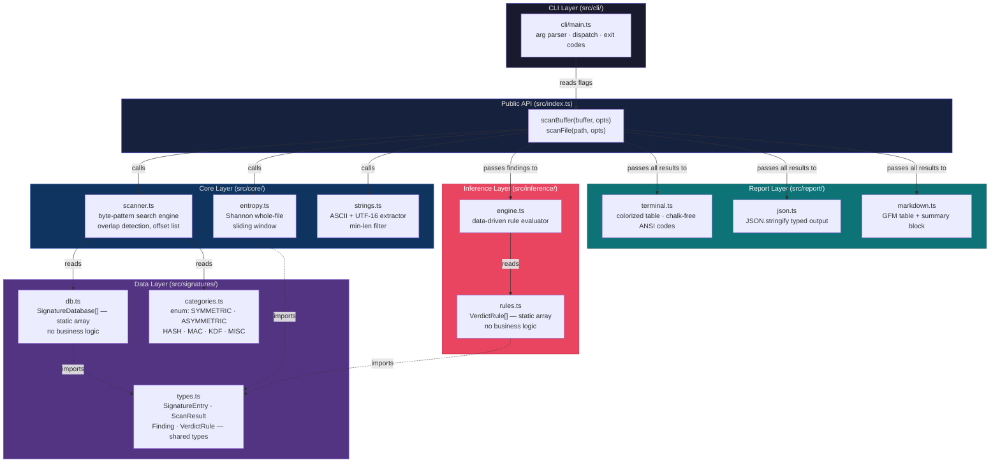
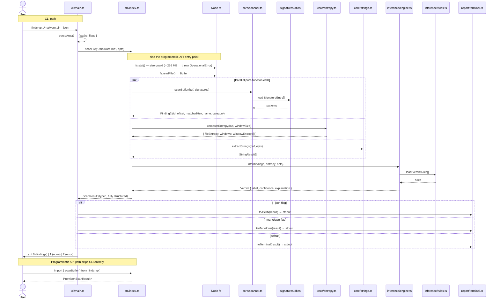

# findcrypt — Architecture Design Brief

> Senior Architect Review · v0.1-draft · 2026-11-22

---

## 1. High-Level Architecture Diagram



**Dependency rule:** arrows flow inward only. `cli` → `api` → `core/inference/report` → `data`. The data layer has zero imports from core. The core layer has zero imports from inference or report. No cycles.

---

## 2. Data-Flow Sequence Diagram



---

## 3. Full Directory Tree

```
findcrypt/
├── .github/
│   └── workflows/
│       └── ci.yml               # matrix: ubuntu/macos/windows × Node 18/20/22
├── src/
│   ├── index.ts                 # PUBLIC API: scanBuffer, scanFile, re-exports types
│   ├── cli/
│   │   └── main.ts              # arg parser, dispatch, exit codes, shebang wrapper
│   ├── core/
│   │   ├── scanner.ts           # Boyer-Moore-Horspool pattern search, overlap dedup
│   │   ├── entropy.ts           # Shannon entropy whole-file + sliding window
│   │   └── strings.ts           # ASCII printable + UTF-16LE string extraction
│   ├── signatures/
│   │   ├── types.ts             # SignatureEntry, Category enum — imported by all layers
│   │   ├── categories.ts        # Category string constants (re-exported from types)
│   │   └── db.ts                # THE DATA FILE: SignatureEntry[] array, one object per sig
│   ├── inference/
│   │   ├── types.ts             # VerdictRule, Verdict — inference-specific types
│   │   ├── rules.ts             # VerdictRule[] data array — zero business logic
│   │   └── engine.ts            # evaluates rules against findings + entropy score
│   └── report/
│       ├── terminal.ts          # ANSI color output, table formatter, hand-rolled
│       ├── json.ts              # JSON.stringify with stable key order
│       └── markdown.ts          # GFM table, copy-paste friendly
├── test/
│   ├── fixtures/
│   │   ├── aes-sbox.bin         # 256 raw bytes of the AES S-box
│   │   ├── sha256-iv.bin        # 32 bytes: SHA-256 initial hash values
│   │   ├── chacha-sigma.bin     # "expand 32-byte k"
│   │   ├── tea-delta.bin        # 0x9E3779B9 LE repeated
│   │   ├── crc32-table.bin      # 1024 bytes: first 256 CRC32 entries
│   │   ├── secp256k1-g.bin      # 65 bytes: uncompressed G point (04 || X || Y)
│   │   ├── high-entropy.bin     # /dev/urandom 4096 bytes
│   │   └── empty.bin            # 0 bytes edge case
│   ├── scanner.test.ts          # positive hit per signature + no false positive on empty
│   ├── entropy.test.ts          # known-value tests (all-zeros → 0.0, random → ~8.0)
│   ├── strings.test.ts          # ASCII + UTF-16 extraction, min-len filter
│   ├── inference.test.ts        # verdict label per known combination
│   ├── report.test.ts           # output format snapshot tests
│   └── cli.smoke.test.ts        # spawn CLI, check stdout + exit code
├── CHANGELOG.md                 # Keep-a-Changelog format; v0.1.0 entry tonight
├── LICENSE                      # MIT
├── README.md                    # see §8 structure below
├── package.json                 # bin, files whitelist, exports map, engines field
├── tsconfig.json                # strict, ESNext, NodeNext, outDir: dist
├── tsconfig.build.json          # extends tsconfig.json, excludes test/
└── vitest.config.ts             # test file globs, coverage provider
```

**File count:** 27 source/config files. Every file has a single stated responsibility.

---

## 4. Scope Matrix

| Feature | Tier | Rationale |
|---|---|---|
| Byte-pattern scanner (BMH) | **MVP** | Core deliverable — everything depends on it |
| AES S-box + inverse S-box | **MVP** | Highest-value signature; FIPS 197 §5.1.1 |
| SHA-256 / SHA-512 IVs | **MVP** | Ubiquitous; RFC 6234 |
| SHA-1 / MD5 IVs | **MVP** | Obsolete-crypto audit use case |
| MD5 T-table (64 constants) | **MVP** | Disambiguates MD5 from SHA-1 IV overlap |
| DES S-boxes | **MVP** | Legacy firmware scanning |
| TEA delta (0x9E3779B9) | **MVP** | CTF instant-win; tiny signature |
| ChaCha20 "expand 32-byte k" | **MVP** | ASCII sigma, easy to anchor |
| Salsa20 "expand 16-byte k" | **MVP** | Alias variant of ChaCha sigma |
| Blowfish P-array (first 8 entries) | **MVP** | Pi-derived, unique enough |
| CRC32 lookup table (first 16 entries anchor) | **MVP** | Firmware/compression audit |
| Base64 std alphabet | **MVP** | Obfuscation detection |
| Base64 URL-safe alphabet | **MVP** | JWT / web crypto indicator |
| secp256k1 generator point | **MVP** | Crypto-wallet indicator; unique 65-byte prefix |
| SM4 S-box + FK constants | **MVP** | Chinese national standard; auditor use case |
| RC4 (no static constant) | **Out** | No table-based signature exists; documented in Limitations |
| Shannon entropy whole-file | **MVP** | Packer/packed detection |
| Shannon entropy sliding window | **MVP** | Localizes encrypted regions |
| ASCII string extraction | **MVP** | Usability + context clues |
| UTF-16LE string extraction | **MVP** | Windows PE binaries |
| Verdict inference engine | **MVP** | The "so what" answer; differentiates from raw dump tools |
| Verdict rules: ransomware pattern | **MVP** | AES + RSA + entropy > 7.5 |
| Verdict rules: crypto wallet | **MVP** | secp256k1 + SHA-256 |
| Verdict rules: packed binary | **MVP** | entropy ≥ 7.9 + no signatures |
| Verdict rules: obsolete crypto | **MVP** | DES or MD5 or SHA-1 present |
| Terminal ANSI report | **MVP** | Primary UX |
| JSON report (--json) | **MVP** | Script-friendly; CI integration |
| Markdown report (--markdown) | **MVP** | PR comments / docs |
| --min-entropy / --no-strings flags | **MVP** | Analyst workflow control |
| npx zero-install run | **MVP** | Usability requirement |
| GitHub Actions CI (3 OS × 3 Node) | **MVP** | Reliability grade |
| PE/ELF/Mach-O section mapping | **Stretch** | Useful but not needed for correctness |
| XOR-key single-byte scan | **Stretch** | Nice-to-have for obfuscation |
| Hash-format identification (hashid-style) | **Stretch** | Different problem domain |
| Demo binary pipeline | **Stretch** | Nice README enhancement |
| YARA rule export | **Out** | Requires YARA runtime; anti-goal |
| Streaming / chunked read | **Out** | Complexity vs. benefit for target file sizes |
| Plugin system | **Out** | Explicit anti-goal |
| WASM / worker threads | **Out** | Explicit anti-goal |
| Disassembly / dynamic analysis | **Out** | Explicit anti-goal |
| Implementing crypto algorithms | **Out** | Explicit anti-goal — detection only |

---

## 5. Top 5 Architectural Risks + Mitigations

### Risk 1 — False Positives from Compressed/Packed Data
**Problem:** CRC32 and Base64 tables appear inside zlib-compressed streams, ZIP headers, or any compressed section of a PE. A match inside a compressed region is meaningless noise that destroys analyst trust.

**Mitigation:**
- Each `Finding` carries a `context` field: 32 bytes before and after the match (hex).
- The terminal report shows context inline; analysts can visually confirm.
- README Limitations section explicitly states: "Matches inside compressed sections require PE section parsing (Stretch goal) to disambiguate."
- Verdict rules treat CRC32-only findings at confidence `LOW` unless corroborated by entropy > 6.5.

---

### Risk 2 — MD5/SHA-1 IV Ambiguity
**Problem:** MD5 and SHA-1 share partial IV overlap in some byte orders. `0x67452301` is MD5's A; `0x67452301` also appears in SHA-1's H0 at the same value. A naive scan triggers both.

**Mitigation:**
- Both are in the DB as separate entries with distinct hex patterns that go beyond the shared word.
- MD5's disambiguator: T-table presence (64 × 32-bit constants) — a separate signature.
- SHA-1's disambiguator: second constant `0xEFCDAB89` immediately adjacent at `+4`.
- `scanner.ts` returns all hits; `inference/engine.ts` applies a "prefer longer / corroborating match" post-filter.
- Both findings are always reported; the report labels them `AMBIGUOUS — verify with context`.

---

### Risk 3 — Memory Cap Behavior
**Problem:** `fs.readFile` on a 300 MB binary in a CI environment or low-RAM analyst machine causes OOM. The contract says 256 MB cap.

**Mitigation:**
- `scanFile` calls `fs.stat()` before read; throws `OperationalError` (exit 2) with a human-readable message: `"File exceeds 256 MB memory cap. Use a hex editor to target specific offsets."`
- The cap is a named constant `MAX_FILE_BYTES = 256 * 1024 * 1024` in `src/index.ts` — exported so consumers can see it programmatically.
- README Limitations documents it explicitly.

---

### Risk 4 — Cross-Platform Terminal Color Handling
**Problem:** Windows cmd.exe / PowerShell 5.1 have inconsistent ANSI support. Node's `process.stdout.hasColors()` and `NO_COLOR` env convention must be honored without pulling in `chalk`.

**Mitigation:**
- `report/terminal.ts` implements a 20-line `ansi(code, text)` helper that checks `process.stdout.isTTY && process.stdout.hasColors()` and the `NO_COLOR` env variable.
- If not TTY or not color-capable → plain text output, identical structure.
- CI smoke tests run with `NO_COLOR=1` to exercise plain path; a separate TTY-mocked test covers color path.
- Zero third-party dependency for this — hand-rolled is 20 lines and fully testable.

---

### Risk 5 — Signature DB Growth / Maintainability
**Problem:** More signatures = more test fixtures + more potential interactions in the verdict rules. As the DB grows, the inference engine must stay tractable.

**Mitigation:**
- `db.ts` is a pure data file — `SignatureEntry[]` with no logic. Adding a signature is editing one array entry and adding one `.bin` fixture. This is the "data not code" architectural invariant.
- `rules.ts` is similarly a pure data file — `VerdictRule[]` where each rule is `{ requires: string[], forbids?: string[], minEntropy?: number, verdict: string }`. New combinations = new array element.
- Verdict rules use signature IDs (strings), not function references — IDE autocomplete + TypeScript catches typos at compile time.
- Minimum test requirement: every entry in `db.ts` must have a corresponding positive test in `scanner.test.ts`. A lint rule (custom `check-fixtures.ts` script run in CI) verifies this invariant automatically.

---

## 6. What Makes This Architecture Defensible in a Job Interview

**"Walk me through your architecture."**

1. **Layered, acyclic dependency graph.** Data layer imports nothing from business-logic layers; core functions are pure (buffer in → results out); inference is policy separate from mechanism. Any layer can be unit-tested in isolation with a fake for the layer below it.

2. **Separation of engine and data is the key design insight.** The student can point to `db.ts` and `rules.ts` as pure JSON-esque data files and `scanner.ts` / `engine.ts` as stable engines that never need touching when new signatures are added. This mirrors production data-driven systems (Snort rules, YARA, Semgrep patterns).

3. **Public API first, CLI second.** The CLI is a 100-line orchestrator over `scanBuffer`/`scanFile`. Every real design decision lives in the library layer. This is the correct architecture for anything that might be integrated into a larger pipeline — the student understands the difference between a tool and a library.

4. **Defensible scope decisions.** The scope matrix has an explicit out-of-scope section with rationale. "We don't do streaming because for the target file sizes (< 256 MB) and use case (interactive triage), the complexity cost outweighs the benefit" is a credible engineering trade-off, not laziness.

5. **Exit codes as a contract.** 0/1/2 with stated semantics means the tool is scriptable by design. Interviewers from infrastructure or DevSecOps backgrounds will recognize this as professional UNIX tool design.

6. **Honest Limitations section in README.** AES-NI has no table (documented). RC4 has no constant (documented). Packed binaries hide signatures (documented). Claiming completeness you can't deliver is a junior mistake. Documenting limits is senior engineering.

---

## 7. Assumptions

1. `npx findcrypt` is the primary UX; the package will be published as `findcrypt` (not scoped) under `kn1ght073`'s npm account. If the name is taken, `@kn1ght073/findcrypt` is the fallback with a 10-minute migration cost.
2. Node 18+ guarantee means `Buffer`, `fs/promises`, and `structuredClone` are available without polyfills.
3. `tsup` is preferred over raw `tsc` for bundling the ESM + CJS dual build (single tsup config replaces two tsc invocations and handles the shebang correctly).
4. The 256 MB cap applies to the input file size, not to the in-memory representation of results (which is always small).
5. "Zero runtime dependencies" means the published `node_modules` is empty. Dev deps (typescript, vitest, tsup) are locked in `devDependencies` and do not ship.
6. GitHub Actions free tier is sufficient for the CI matrix (ubuntu-latest / macos-latest / windows-latest).

---

## 8. README Structure (enforced outline)

```
# findcrypt

> npm install -g findcrypt | npx findcrypt

## Why This Exists
  [4 use cases: malware triage, CTF, security audit, vendor claims]

## Quick Start / Live Demo
  [asciinema or screenshot — added after MVP publish]

## Usage
  ### CLI
  ### Programmatic API

## Methodology — Why Crypto Leaves Fingerprints
  [cite FIPS 197, RFC 7539, RFC 4634; explain table-driven implementations]

## Signature Dictionary
  [table: id | name | category | byte pattern excerpt | what finding it means]

## Verdict Combinations
  [table: combination → verdict label]

## Limitations (Honest)
  - AES-NI: no S-box in memory
  - RC4: no static constant
  - Packed/obfuscated binaries: signatures may be absent or encrypted
  - 256 MB file size cap
  - Proof of absence: a clean scan does not prove absence of crypto

## Contributing — Adding a Signature
  [step-by-step: add entry to db.ts, add .bin fixture, add test]

## License
  MIT
```

---

> **Build order for tonight:** types → db.ts → scanner.ts → entropy.ts → strings.ts → engine.ts → report layer → index.ts → cli/main.ts → tests → CI → publish v0.1.0
